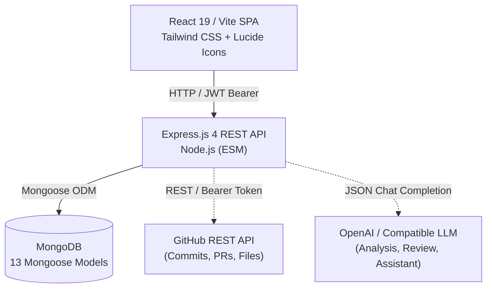
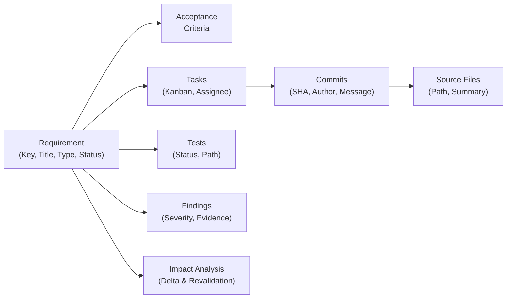

# DevIntel — AI-Powered Software Engineering Intelligence Platform

DevIntel is an enterprise-grade engineering intelligence platform that establishes persistent **Requirement-to-Code Traceability** and **Automated Change-Impact Analysis**. It bridges the disconnect between product specifications, development tasks, version control, automated tests, code review findings, and overall project health.

---

## 1. Problem Statement & Motivation

In traditional software development workflows, artifacts exist in isolated silos:
- Product requirements live in Jira, Linear, or PRD documents.
- Code changes and pull requests live in GitHub or GitLab.
- Test suites live in CI pipelines.
- Security and quality issues live in static analysis tools or code reviews.

When a requirement changes (e.g., modifying a file upload limit or authentication rule), engineering teams face critical questions:
- *Which tasks implement this requirement?*
- *Which source files enforce the constraint?*
- *Which automated tests validate this behavior?*
- *What code review findings or vulnerabilities exist?*
- *What breaks or requires revalidation when the requirement is modified?*

DevIntel solves this by maintaining a bidirectional, queryable traceability graph that connects every requirement to its implementation evidence and automatically generates impact reports whenever requirements evolve.

---

## 2. Key Differentiator: Traceability & Impact Analysis

DevIntel is **not** just another task tracker, code generator, or chatbot. Its core differentiators are:

1. **Persistent Traceability Graph:** Every requirement is linked to concrete database artifacts:
   ```
   Requirement (REQ-001)
     ├── Acceptance Criteria (5 defined)
     ├── Tasks (TASK-001, TASK-002, TASK-003)
     │     └── Commits (feat: add upload endpoint, feat: validate 5MB limit)
     │           └── Source Files (uploadController.js, fileValidation.js, storageService.js)
     ├── Automated Tests (upload.test.js — PASSING)
     └── Review Findings (FIND-001: WebP missing, FIND-002: size limit mismatch)
   ```
2. **Rule-Based & AI-Assisted Change-Impact Engine:** When requirement specifications change (e.g., from 5 MB to 2 MB, or adding WebP support), the platform traverses the graph to determine:
   - `DIRECTLY_LINKED` tasks needing immediate revision
   - `REQUIRES_REVALIDATION` source code and test files requiring rerun
   - `POTENTIALLY_AFFECTED` commits, pull requests, and review findings
   - Each impact includes **confidence score**, **verification status**, and **concrete evidence**.
3. **Automated Project Health & Risk Engine:** Computes a project health score and surfaces actionable risk items (e.g., requirements without tests, blocked tasks, unverified findings, and unvalidated changes).

---

## 3. System Architecture



### Traceability Chain



---

## 4. Features & Modules

| Module | Features |
|---|---|
| **Authentication & Security** | JWT tokens (7-day expiry), bcrypt password hashing (12 rounds), Helmet security headers, CORS origin protection, Express rate limiting on auth endpoints, centralized error handler. |
| **Project Management** | Workspace project switcher, GitHub repository linkage, owner-based authorization, cascade delete of all linked artifacts. |
| **Requirements Management** | Unique identifiers (`REQ-xxx`), acceptance criteria editor, type classification (`FUNCTIONAL`, `SECURITY`, `PERFORMANCE`, etc.), priorities (`LOW` to `CRITICAL`), statuses (`DRAFT`, `READY`, `IN_PROGRESS`, `IMPLEMENTED`, `VERIFIED`, `CHANGED`, `AT_RISK`), live search and filtering. |
| **Requirement Versioning** | Automated version snapshots (`RequirementVersion`) on content changes, diff summaries, change timestamp, and impact status tracking. |
| **Change-Impact Analysis** | Graph traversal upon requirement modification, identifying affected tasks, source files, tests, commits, and findings. Each impact item includes relationship category, reason, evidence, confidence, and verification status. |
| **Traceability Visualizer** | Interactive relationship map displaying connected artifact counts, node linkages, and detailed artifact inspection cards. |
| **Task Board (Kanban)** | 5-column Kanban board (`TODO`, `IN_PROGRESS`, `REVIEW`, `DONE`, `BLOCKED`), sprint assignment, estimated effort, dependencies, requirement badge, and inline status updates. |
| **Project Health & Risk Engine** | Automated risk detector evaluating missing tests, unassigned tasks, blocked tasks, unresolved critical findings, and changed requirements awaiting revalidation. Calculates overall health score (0–100). |
| **AI Requirement Analysis** | Deconstructs natural language requirements into structured acceptance criteria, edge cases, validation rules, development tasks, and suggested test cases. |
| **AI Code Review** | Analyzes source code against requirement context to detect vulnerabilities, logic flaws, and validation mismatches. Generates structured findings with severity, confidence, and exact code evidence. |
| **Project Assistant** | Grounded Q&A assistant utilizing project records. Operates deterministically from MongoDB data or with LLM assistance when configured. |
| **GitHub Integration** | Synchronizes commits, pull requests, and modified files via GitHub REST API. Automatically infers linkages when commit messages cite requirement/task keys. Seamless demo fallback. |

---

## 5. Technology Stack

- **Frontend:** React 19, Vite 6, Tailwind CSS 4, React Router 7, Lucide React, Axios
- **Backend:** Node.js 22, Express.js 4, Mongoose 8, JWT, bcryptjs, Helmet, Express Rate Limit
- **Database:** MongoDB (Local or MongoDB Atlas with automatic fallback)
- **Integrations:** GitHub REST API v3, OpenAI / OpenAI-compatible Chat Completions API

---

## 6. Database Models (Mongoose)

1. **`User`** — Account details, password hash, email uniqueness.
2. **`Project`** — Name, repository metadata, owner and member ObjectIds.
3. **`Requirement`** — Key (`REQ-xxx`), title, description, type, priority, status, acceptance criteria, revision count.
4. **`RequirementVersion`** — Version history snapshots, delta summary, timestamp, impact status.
5. **`Task`** — Key (`TASK-xxx`), title, requirement reference, status, priority, assignee, estimate, dependencies, sprint.
6. **`Sprint`** — Name, status (`PLANNED`, `ACTIVE`, `COMPLETED`), start and end dates.
7. **`Commit`** — SHA, message, author, committed timestamp, affected files list, demo flag.
8. **`PullRequest`** — PR number, title, state (`open`, `merged`, `closed`), changed files list.
9. **`SourceFile`** — Path, language, functional summary, task and requirement linkages.
10. **`Test`** — Name, test file path, execution status (`PASSING`, `FAILING`, `UNKNOWN`), last run date.
11. **`Finding`** — Key (`FIND-xxx`), title, severity (`CRITICAL`, `HIGH`, `MEDIUM`, `LOW`, `INFO`), category, description, exact evidence excerpt, confidence, verification status.
12. **`TraceabilityLink`** — Persistent requirement-to-artifact mapping with composite unique index.
13. **`ImpactAnalysis`** — Previous vs. current requirement snapshot, impacts array with confidence and verification status.

---

## 7. Setup & Execution

### Prerequisites
- Node.js 20 or newer
- npm
- MongoDB running locally (e.g. `mongodb://127.0.0.1:27017`) or a MongoDB Atlas URI

### Step 1: Install Dependencies
```powershell
npm install
```

### Step 2: Environment Configuration
Copy the template environment file:
```powershell
Copy-Item .env.example .env
```

Ensure `.env` contains:
```env
PORT=4000
MONGODB_URI=mongodb://127.0.0.1:27017/devintel
JWT_SECRET=<a private random value of at least 24 characters>
CLIENT_URL=http://localhost:5173
MONGODB_FALLBACK_URI=mongodb://127.0.0.1:27017/devintel_local
```
*(Optional: set `GITHUB_TOKEN` and `AI_API_KEY` for live integrations).*

### Step 3: Demo Dataset
The API seeds the ShopSphere demo workspace automatically on first start (when `DEMO_MODE` is not `false`). To reset it manually:
```powershell
npm run seed
```

### Step 4: Run the Application
Start both the API server and Vite client concurrently:
```powershell
npm run dev
```

- **Frontend:** http://localhost:5173
- **Backend API:** http://localhost:4000
- **Health Check:** http://localhost:4000/api/health

### Demo Credentials
- **Email:** `demo@devintel.local`
- **Password:** `DevIntelDemo123!`
- One-click entry: **Launch Demo Workspace** on the login page, or http://localhost:5173/demo

### Production build
```powershell
npm run build
npm start   # serves the API and the built app on http://localhost:4000
```

---

## 8. Examiner Demonstration Walkthrough

The demo workspace is **ShopSphere — E-Commerce Platform**: 10 requirements, 33 tasks across 4 sprints, 23 commits, 9 pull requests, 15 source files and 8 test suites (with stored source snapshots), 10 review findings, and an activity history — all connected through `TraceabilityLink` records. It is seeded automatically the first time the API starts, and can be reset at any time.

### Step 1: Enter the demo workspace
- Open http://localhost:5173 and click **Launch Demo Workspace** (or open http://localhost:5173/demo to sign in directly).
- Demo account: `demo@devintel.local` / `DevIntelDemo123!`. Real registration and login remain available.

### Step 2: Dashboard
- Project health score, requirement coverage, traceability coverage, open risks and **Needs revalidation: 0**.
- Requirements, Engineering, Code intelligence and Quality groups — every number is computed from the database.
- Team activity timeline (task moves, merged PRs, AI review findings, verifications).

### Step 3: REQ-006 — Profile Image Upload Validation
- Requirements → **REQ-006**. Initial text: *"Users can upload profile images up to 5 MB in JPEG or PNG format."*
- The evidence chain shows Requirement → 6 acceptance criteria → TASK-021/022/023 → commits `abc1230`, `def4564`, `a9e7890` → PR #42 → `uploadController.js`, `fileValidation.js`, `storageService.js` → `upload.test.js`, `fileValidation.test.js` → FIND-006.
- Click any artifact: related artifacts highlight, and a details drawer opens (task details, commit files, PR files, **source code snapshot**, test source). Links inside the drawer navigate the graph.

### Step 4: Live requirement change
- Click **Edit requirement** and change the description to *"Users can upload profile images up to 2 MB in JPEG, PNG or WebP format."* → **Save changes**.
- The requirement becomes revision 2, status **CHANGED**; the previous version is snapshotted.
- Click **Analyze Change Impact**.

### Step 5: Change-impact report
- **Before vs after:** 5 MB → 2 MB; JPEG, PNG → JPEG, PNG, **+ WebP**.
- **What changed / what is affected / what needs revalidation.**
- **Directly affected:** TASK-022, `fileValidation.js` (L2 `MAX_FILE_SIZE = 5 * 1024 * 1024`, L3 MIME allow-list without WebP), `uploadController.js` (L8 multer `fileSize` limit).
- **Potentially affected:** TASK-021, TASK-023, the three commits and PR #42. **Requires revalidation:** both test files and FIND-006.
- **Gaps** (line-cited), **risks** (HIGH: size restriction not satisfied; MEDIUM: WebP support; MEDIUM: tests), and **recommended actions**.
- Every item shows impact level, reason, evidence, confidence and verification status. `VERIFIED` is only used where the engine actually inspected the stored source/test snapshot or requirement text.

### Step 6: Project health reflects the change
- Dashboard: revalidation banner, **Needs revalidation: 1 (REQ-006)**, lower health score. Project health lists REQ-006 under *Requirements requiring revalidation*.

### Step 7: Project assistant
- Ask: *Why is REQ-006 at risk?*, *Which tasks are affected by REQ-006?*, *Which files are linked to the profile image requirement?*, *What changed in REQ-006?*, *Which tests need revalidation?*, *Show requirements without linked tests.*
- Answers are computed from stored records and labelled **DATABASE-BACKED · NO AI** (or **AI SUGGESTION** when an AI provider is configured and used).

### Resetting between rehearsals
- Settings → **Reset demo workspace**, or `npm run seed`. Both restore REQ-006 to 5 MB / JPEG + PNG.

---

## 9. API Overview

All application endpoints are served under `/api/v1` and require `Authorization: Bearer <token>` (except `/auth/register` and `/auth/login`).

| Resource | Method & Route | Description |
|---|---|---|
| **Auth** | `POST /auth/register` | Register new user, hashes password, returns JWT. |
| | `POST /auth/login` | Authenticate credentials, returns user & JWT. |
| | `GET /auth/me` | Fetch active user profile from JWT. |
| **Projects** | `GET /projects` | List projects for authenticated user. |
| | `POST /projects` | Create new project with optional GitHub repository URL. |
| | `PATCH /projects/:projectId` | Update project metadata. |
| | `DELETE /projects/:projectId` | Cascade delete project and all linked artifacts. |
| **Dashboard** | `GET /projects/:projectId/dashboard` | Aggregated coverage, tasks, findings, and traceability metrics. |
| **Health** | `GET /projects/:projectId/health` | Project risk engine: detects gaps, computes health score (0–100). |
| **Requirements** | `GET /projects/:projectId/requirements` | Query requirements with optional `search`, `status`, `priority`, `type`. |
| | `POST /projects/:projectId/requirements` | Create requirement with acceptance criteria. |
| | `GET /requirements/:requirementId` | Fetch requirement detail. |
| | `PATCH /requirements/:requirementId` | Update requirement, snapshots version, generates impact report. |
| | `GET /requirements/:requirementId/history`| List historical version snapshots for requirement. |
| | `POST /requirements/:requirementId/analyze`| AI-assisted requirement decomposition into edge cases and tests. |
| **Tasks** | `GET /projects/:projectId/tasks` | List project tasks with requirement populate. |
| | `POST /projects/:projectId/tasks` | Create task, link to requirement, assign sprint and estimate. |
| | `PATCH /tasks/:taskId` | Update task status, assignee, priority, dependencies. |
| **Traceability** | `GET /projects/:projectId/traceability/:requirementId` | Fetch complete graph of all artifacts linked to requirement. |
| **Impact** | `GET /projects/:projectId/impact-analysis` | Fetch all historical change-impact reports for project. |
| **Code Review** | `POST /projects/:projectId/reviews/analyze` | Submit source code for AI-assisted review. |
| | `GET /projects/:projectId/reviews` | List recorded code review findings with verification status. |
| **Assistant** | `POST /projects/:projectId/assistant` | Query project data using deterministic rule engine or LLM. |
| **GitHub** | `GET /projects/:projectId/github` | Fetch stored commits and PRs. |
| | `POST /projects/:projectId/github/sync` | Sync recent commits and PRs via GitHub REST API. |
| **Demo** | `POST /auth/demo` | One-click sign-in to the seeded demo workspace (only when DEMO_MODE is enabled). |
| | `POST /demo/reset` | Restore the demo workspace (demo account only). |
| **Change impact** | `POST /requirements/:requirementId/impact-analysis` | Analyse an unanalysed requirement change: constraint diff, affected artifacts, gaps, risks, actions. |
| | `POST /requirements/:requirementId/revalidate` | Resolve the open impact report and mark the requirement verified. |
| **Traceability** | `GET /projects/:projectId/traceability` | Requirement traceability matrix. |
| | `GET /projects/:projectId/artifacts/:type/:id` | Artifact details with related commits, PRs, files, tests and findings. |
| **Activity** | `GET /projects/:projectId/activity` | Project activity timeline. |

---

## 10. Limitations & Future Roadmap

- **Live CI/CD Integration:** Currently tests and findings are linked via API/seed; future integration with GitHub Actions or JUnit XML reports will automate test status updates.
- **WebSocket Live Updates:** Currently updates refresh via React state; adding WebSocket events would provide live multi-user collaboration on the Kanban board.
- **Git Webhook Receivers:** The current implementation supports manual on-demand sync; a webhook receiver for push and pull_request events would automate ingestion.

---

## 11. Academic Integrity & Verification Notice

- DevIntel clearly distinguishes between **VERIFIED** database facts and **AI SUGGESTIONS**.
- Demo GitHub data is explicitly flagged as `DEMO DATA`.
- No conclusions or findings are fabricated without attached evidence and confidence scores.
